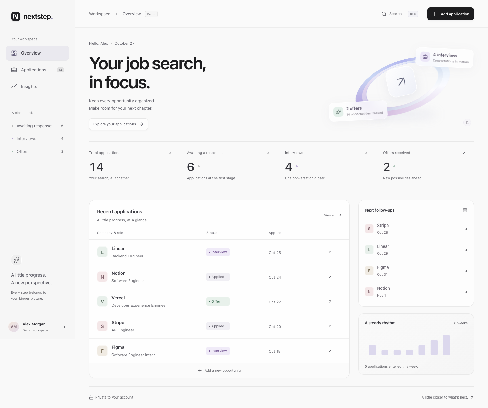

# Nextstep

[](https://github.com/bagdaulet-dev/nextstep/actions/workflows/ci.yml)

A private job application tracker built with **Python, Django REST Framework, MySQL, React and TypeScript**. Track applications, move them through interview stages, schedule follow-ups and see your activity in one workspace.

The interface uses silver surfaces, graphite typography, glass details and a CSS orbit animation. It supports small screens, keyboard navigation and reduced motion. All dashboard numbers come from the signed-in account’s database records.



## What you can do

- Create an account, sign in and sign out with server-side cookie sessions.
- Add, edit and delete applications with company, role, location, work mode, job link, dates and notes.
- Move applications through **Applied → Interview → Offer / Rejected**. Transitions are flexible, so corrections are possible.
- Search company and role; filter by status and work mode; sort and paginate results.
- Read timestamped status history, view eight weeks of activity and review follow-ups.
- Export your own records as JSON or permanently delete your account and its applications.
- Explore fictional records in a separate demo account. Demo access expires after 24 hours.

## Stack

| Layer          | Choice                                                               |
| -------------- | -------------------------------------------------------------------- |
| Backend        | Python 3.12+, Django 5.2 LTS, Django REST Framework                  |
| Persistence    | MySQL 8.4, Django ORM and Django migrations                          |
| Interface      | React, TypeScript, Vite, Lucide icons, custom CSS                    |
| Authentication | Django sessions, CSRF protection, Argon2 password hashes             |
| API reference  | OpenAPI with drf-spectacular and locally served Swagger UI           |
| Verification   | pytest, pytest-django, Ruff, Playwright, Prettier, dependency audits |
| Delivery       | Multi-stage Docker image, Docker Compose, GitHub Actions             |

SQLite is provided **only for a lightweight local preview**; the full stack and database concurrency tests use MySQL. Preview and MySQL use separate databases; records do not move automatically between modes.

## Start the lightweight preview

Requirements: Python **3.12 or later**, Node **24** and npm. Docker and MySQL are unnecessary for this preview.

```sh
git clone https://github.com/bagdaulet-dev/nextstep.git
cd nextstep
./scripts/preview.sh
```

If your `python3` is older, point the script at a newer interpreter:

```sh
PYTHON_BIN=/path/to/python3.12 ./scripts/preview.sh
```

Open **http://localhost:8002/** and choose **Explore the demo**, or create your own empty account. Stop the server with `Ctrl+C`. The script installs dependencies, builds the interface, applies migrations and starts Django on localhost. Your local preview data stays in the ignored `.local/` directory.

When dependencies are already installed, rebuild/restart with:

```sh
npm run build
APP_MODE=preview DJANGO_DEBUG=true DJANGO_SSL_REDIRECT=false DJANGO_SECURE_COOKIES=false .venv/bin/python backend/manage.py migrate
APP_MODE=preview DJANGO_DEBUG=true DJANGO_SSL_REDIRECT=false DJANGO_SECURE_COOKIES=false .venv/bin/python backend/manage.py runserver 127.0.0.1:8002 --noreload
```

Restart the Django preview after rebuilding: its template cache can otherwise reference a previous build’s asset names.

## Start the full MySQL stack

Requirements: Docker Desktop with Compose. Stop another preview using port 8002 first.

```sh
python3 scripts/setup-env.py
docker compose up --build -d --wait
```

The setup script creates `.env` with unique local secrets and restrictive file permissions. If the file already exists, it leaves it unchanged. The example file contains placeholders, not production credentials.

Open **http://localhost:8002/**. Compose starts MySQL, waits for its health check, applies migrations, creates the shared throttle cache, removes expired demo records and runs Gunicorn as a non-root user. Only the application is exposed, on your Mac’s localhost address. MySQL stays inside Docker’s network.

```sh
docker compose logs --tail=60 app
docker compose stop
```

`stop` releases running container resources and keeps database data. `docker compose down` also removes these containers and their network, while keeping the named database volume. Quit Docker Desktop afterward to release its VM resources. Do not add `--volumes` unless you intend to erase the database.

The supplied Compose configuration is a **local development setup**. See [operations](docs/operations.md) before hosting it publicly.

## Development and checks

```sh
APP_MODE=preview .venv/bin/pytest --cov --cov-fail-under=90
.venv/bin/ruff check backend scripts/setup-env.py
.venv/bin/ruff format --check backend scripts/setup-env.py
npm run format:check
npm run build
npm run test:browser
npm run test:docs
npm audit --audit-level=high
.venv/bin/pip-audit -r backend/requirements.txt --no-deps --disable-pip
```

The browser test expects a running preview on port 8002 and installed Chrome. It uses isolated browser sessions and fictional data. Override `BASE_URL` to test a different local port. CI installs Playwright Chromium and sets `BROWSER_CHANNEL=chromium`.

For fast interface work, start the Django API in preview mode and run `npm run dev` in a second terminal. Vite serves the interface on http://localhost:5173/static/ and proxies `/api` to port 8002.

**CI** checks formatting, the frontend build, preview and MySQL tests, OpenAPI, production configuration, audits, the browser journey and the Docker image. The separate **manual image publishing workflow** reruns verification before pushing an image to GitHub Container Registry. It does not deploy to a server. The verification workflow runs on changes to `main` and on pull requests. Container publishing is an explicit manual action.

## Project structure

```text
backend/
  accounts/         Custom user, registration, sessions, export and deletion
  tracker/          Applications, status events, queries and statistics
  config/           Settings, URL routing, request boundaries and errors
  tests/            API, privacy, CSRF and MySQL concurrency tests
frontend/
  src/components/   Auth, dashboard, application editor, details and insights
  src/styles/       Base, component and responsive styles
scripts/            Local preview, environment setup, container entrypoint, browser test
docs/               API, architecture, security, operations and screenshots
.github/workflows/  Verification and manual image publishing
```

## Design and implementation notes

Private records are scoped to the authenticated user at the query level. Clients cannot choose an owner or submit read-only fields. Status updates and their history use database transactions; MySQL row locks also protect simultaneous changes and account capacity checks.

The interface never stores authentication tokens in browser storage. It uses HttpOnly cookies and a CSRF token held in memory. No external analytics, web fonts or company logo requests are needed. Notes are rendered as text.

This is a portfolio application with documented operational limits, not a claim of legal certification or a completed independent security audit. Read the [security model](docs/security.md) for session, retention and rate-limit details.

- [API reference](docs/api.md)
- [Architecture](docs/architecture.md)
- [Local and production operations](docs/operations.md)
- [Verification results](docs/verification.md)

For contributions, see [CONTRIBUTING.md](CONTRIBUTING.md). Report vulnerabilities through the process in [SECURITY.md](SECURITY.md).
