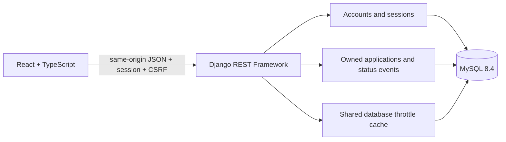
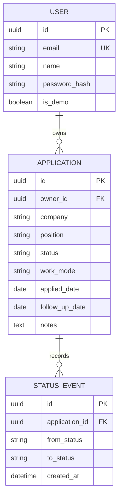

# Architecture

The built interface and API share an origin. Django and WhiteNoise serve Vite’s static output; Gunicorn runs Django in the container. During interface development, Vite proxies API calls to the local Django server.

## Backend boundaries

`accounts` owns the UUID user model, email/password authentication, session responses, private demos, export and deletion. `tracker` owns application records, status history and summary queries. `config` contains environment settings, request limits, errors, security headers and routing.

Serializers validate input at the API boundary. Application queries begin with `owner=request.user`. The browser cannot submit an owner, so it cannot reassign records. Object lookups use the scoped queryset and return 404 for another user’s UUID.

Creation, partial updates and deletion use transactions. Creating an application also creates its initial event. An update locks the application row before reading its previous status and writing a new event. Repeating the same status creates no duplicate event. Only the latest 100 events are retained. Creation locks the user row before checking the 1,000-record limit, preventing simultaneous requests from exceeding it on MySQL.

Statistics read the owned queryset. Activity groups dates into eight Monday-starting weeks in Python after a bounded database aggregate, avoiding a dependency on MySQL timezone tables. Follow-ups show the first four active applications by follow-up date, including overdue items. These are reminders in the interface; the app sends no emails or notifications.

## Data model

Django also stores server-side sessions and, in MySQL mode, throttle cache entries. Composite indexes cover owner/status and owner/application date. Foreign keys cascade account and application deletion to their child records.

## Interface boundaries

- `api.ts` handles same-origin requests, JSON errors, timeout/cancellation and the in-memory CSRF token.
- `auth.tsx` owns the current session and reloads it after expiry.
- `data.ts` loads the list and statistics and cancels stale reads.
- Components own the dashboard, collection, insights, editor, details drawer and account dialog.
- Native dialogs provide focus containment and Escape handling. Busy mutations temporarily prevent closing their dialog.

The interface keeps only the current view in the URL. Search/filter state is temporary. Authentication is never persisted in localStorage. Motion uses CSS; its long-running decoration has a pause control and respects the system’s reduced-motion setting.

## Runtime modes

| Mode      | Database     | Cache                 | Purpose                                          |
| --------- | ------------ | --------------------- | ------------------------------------------------ |
| `preview` | Local SQLite | Process memory        | Low-resource visual preview and most tests       |
| `mysql`   | MySQL        | Shared database table | Full stack and row-lock concurrency verification |

SQLite does not provide MySQL’s row-lock semantics. The two concurrency tests deliberately run only with the MySQL profile. Both modes use the same Django models, migrations and API implementation.
